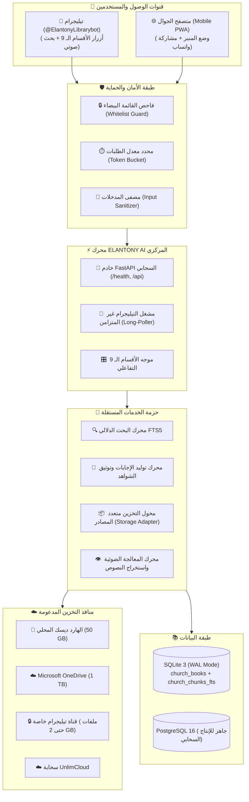

# 🏛️ المعمارية الهندسية لمنظومة ELANTONY LIBRARY AI
**وثيقة التصميم المعماري (System Architecture Document)**  
**الإصدار:** 2.0.0 (Enterprise Modular Monolith)

---

## 1. فلسفة التصميم (Design Principles)

تم بناء منظومة **ELANTONY LIBRARY AI** كمعمارية **Modular Monolith** متكاملة وقابلة للتوسع المستقبلي لتخدم مكتبة كنسية تضم أكثر من **7,200 مجلد (50 GB)** مع تحقيق المبادئ التالية:

1. **الاستقلالية والفصل الصارم بين الطبقات (Separation of Concerns):**
   - طبقة تيليجرام (`elantony.telegram`) لا تعرف شيئاً عن تفاصيل تخزين الملفات أو نوع قاعدة البيانات.
   - طبقة التخزين (`elantony.storage`) توفر عقداً موحداً بغض النظر عما إذا كان الملف محلياً، أو على OneDrive، أو قناة تيليجرام خاصة.
2. **العمل المستقل على مدار الساعة (24/7 Cloud-Native):**
   - التطبيق مصمم للعمل كخدمة خلفية (Headless Daemon) في حاوية Docker لا تحتاج إلى واجهات سطح المكتب ولا إلى بقاء جهاز المستخدم الشخصي مفتوحاً.
3. **الأمان الصارم وحماية الأسرار (Zero-Trust & Secret Isolation):**
   - منع استخدام أي توكن أو كلمة مرور داخل الكود البرمجي نهائياً، والاعتماد الحصري على المتغيرات البيئية (`.env`).
   - التحكم الصارم في الوصول عبر القائمة البيضاء (`User ID Whitelist`) ومعدل الاستخدام (`Rate Limiting`).
4. **منع التزييف والهلوسة اللاهوتية (Strict Grounded RAG):**
   - محرك الذكاء الاصطناعي مقيد بالنصوص والشواهد المسترجعة فعلياً من بطون أمهات الكتب مع ذكر اسم الكتاب ورقم الصفحة بدقة.

---

## 2. المخطط المعماري الشامل (Architecture Diagram)

---

## 3. تفصيل طبقات المنظومة (System Layers)

### 1. طبقة النواة والأمان (`elantony.core`)
- **`config.py`:** تحميل الإعدادات من `.env` والتحقق من صحتها عبر Pydantic.
- **`security.py`:** التحقق من هوية مستخدم تيليجرام (`is_user_authorized`)، والصلاحيات الإدارية (`is_user_admin`)، وتطهير النصوص من الرموز الخبيثة.
- **`rate_limiter.py`:** نافذة زمنية منزلقة (Sliding Window) بحد أقصى 30 طلباً في الدقيقة لكل مستخدم لمنع الإغراق.
- **`logging.py`:** تسجيل الأحداث وتتبع الأخطاء مع تدوير تلقائي للملفات (Rotating File Handler).

### 2. طبقة البيانات المستقلة (`elantony.database`)
- **`connection.py`:** إدارة اتصالات SQLite بنمط `WAL` فائق السرعة، ومصنع اتصالات PostgreSQL للبيئة السحابية.
- **`models.py`:** كيانات بيانات موحدة لكافة سمات الكتب الـ 16، والمقاطع الدلالية، وأبحاث المستخدمين المحفوظة.
- **`repository.py`:** مستودع العمليات لجميع استعلامات الفهرسة، البحث، الأقسام، والمؤلفين.

### 3. طبقة التخزين متعدد المصادر (`elantony.storage`)
- **`BaseStorageAdapter`:** واجهة برمجية موحدة تحدد دوال الاستعلام، والتحقق، والرفع، والتنزيل.
- **المحولات المنفذة:**
  - `LocalStorageAdapter`: يدير الكتب على القرص الصلب الحالي.
  - `TelegramChannelStorageAdapter`: رفع واسترجاع الملفات عبر File ID في قناة خاصة مشفرة.
  - `OneDriveStorageAdapter`: التكامل مع Microsoft Graph API وسعة الـ 1 TB.
  - `UnlimCloudStorageAdapter`: تكامل مع تحذيرات الأمان والسياسات.

### 4. طبقة البحث والذكاء الاصطناعي (`elantony.search` & `elantony.ai`)
- **`SearchEngine`:** استعلامات FTS5 المركبة، والبحث المحصور داخل كتاب واحد (Ask-a-Book)، والبحث الآبائي حسب الموضوع.
- **`RuleBasedChurchProvider`:** صياغة إجابات لاهوتية مع التوثيق الكامل دون أي تكلفة سحابية ودون أدنى احتمال للهلوثة.
- **`GeminiAIProvider`:** استدعاء النماذج اللغوية الكبيرة مع توجيهات صارمة بالاقتصار على النصوص المسترجعة.

### 5. طبقة تيليجرام الاحترافية (`elantony.telegram`)
- **القائمة الرئيسية الموحدة (9 أقسام):**
  1. `🤖 المساعد الذكي`: استفسارات RAG فورية مع شواهد الصفحات.
  2. `📚 البحث في المكتبة`: استعلام عن أسماء الكتب وتحميلها PDF.
  3. `📖 اسأل كتابًا`: حصر السؤال والبحث في كتاب واحد يختاره المستخدم.
  4. `⛪ أقوال الآباء`: مختارات آبائية مصنفة حسب الفضائل الروحية.
  5. `🔍 البحث حسب المؤلف`: تصفح كتب قداسة البابا شنودة، القديس أثناسيوس، القديس كيرلس، الأنبا أنطونيوس، القديس جيروم، والأب متى المسكين.
  6. `📂 تصفح التصنيفات`: استعراض أقسام الأبائيات، العقيدة، التفاسير، والطقوس.
  7. `📑 أبحاثي المحفوظة`: سجل الشواهد المفضلة للمستخدم مع إمكانية حذفها أو مراجعتها.
  8. `⚙️ الإعدادات`: كشف الهوية، حالة السيرفر، وسقف الاستخدام.
  9. `ℹ️ حول المكتبة`: بيانات المنظومة والتوثيق الكنسي.
