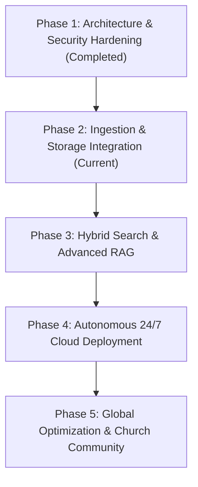

# 🗺️ ELANTONY LIBRARY AI — Comprehensive Development Roadmap

## Executive Overview
**ELANTONY LIBRARY AI** is an enterprise-grade ecclesiastical AI and digital library management platform engineered to catalog, index, and query approximately **7,200 ecclesiastical volumes (~50 GB)**. This roadmap outlines the strategic phases to evolve the system from the current operational modular prototype to full-scale autonomous 24/7 cloud production.

---

## Phase 1: Architectural Refactoring & Security Baseline *(Status: Completed)*
* **Objective:** Decouple monolithic scripts into an extensible Modular Monolith, isolate secrets, and secure the `@ElantonyLibrarybot` Telegram interface.
* **Key Deliverables:**
  - [x] Full security audit and secret extraction to `.env` (sanitized `.env.example` and enforced `.gitignore`).
  - [x] Verified FatherBot webhook state (`url: ''`, pure Long Polling maintained).
  - [x] Architecture design (`ARCHITECTURE.md`) and comprehensive codebase audit (`PROJECT_AUDIT_REPORT.md`).
  - [x] Creation of the core modular package `elantony/`:
    - `elantony/core/`: Strongly typed configuration, sliding-window rate limiter, and role-based access control.
    - `elantony/database/`: SQLite WAL connection manager, Pydantic data entities, migration support.
    - `elantony/storage/`: Multi-provider abstraction (Local, Telegram Channel, OneDrive, UnlimCloud).
    - `elantony/search/`: SQLite FTS5 search engine with `unicode61` tokenizer.
    - `elantony/ai/`: Rule-based zero-cost provider with anti-hallucination citation guarantee.
    - `elantony/telegram/`: 9-section reply keyboard, inline callback routing, and state machine.
    - `elantony/web/`: FastAPI container health check endpoint (`/health`).
  - [x] Automated test suite: 38/38 tests passing with pytest.

---

## Phase 2: High-Throughput Ingestion & Multi-Cloud Storage *(Target: Weeks 1–3)*
* **Objective:** Expand the catalog from the current 497 books to all ~7,200 physical and scanned volumes (~50 GB), with background OCR and resilient storage replication.
* **Key Workstreams:**
  1. **Automated Batch Discovery:**
     - Recursive scanning across external volumes (`I:\`, external backup SSDs).
     - Incremental cataloging with SHA-256 deduplication and change detection.
     - Extraction of page count, file size, format (`pdf`, `docx`, `epub`).
  2. **Multi-Engine OCR Pipeline:**
     - Parallel background worker queue using Python `multiprocessing` or Celery.
     - Primary engine: Tesseract 5.3+ (`ara`, `eng`).
     - Secondary engine: EasyOCR for low-contrast/aged church manuscripts.
     - Optical image preprocessing: deskewing, binarization (Otsu thresholding), and shadow removal.
  3. **Multi-Provider Cloud Storage Binding:**
     - **Primary Active Storage:** Microsoft OneDrive (1 TB) via Microsoft Graph API for streaming on-demand downloads.
     - **Secondary Resilient Archive:** Private Telegram Channel acting as a zero-cost distributed document CDN (splitting files > 50 MB into parts for Bot API or using MTProto up to 2 GB).
     - Local caching mechanism with Least Recently Used (LRU) eviction to bound disk consumption on low-cost servers.

---

## Phase 3: Hybrid Search & Advanced Patristic RAG *(Target: Weeks 4–6)*
* **Objective:** Elevate search precision beyond keyword matching to ecclesiastical semantic understanding with zero-hallucination guarantees.
* **Key Workstreams:**
  1. **Hybrid Retrieval (Lexical + Semantic):**
     - Combine SQLite FTS5 BM25 scoring with dense vector embeddings (e.g., `sentence-transformers/paraphrase-multilingual-MiniLM-L12-v2` or BGE-M3).
     - Reciprocal Rank Fusion (RRF) algorithm to merge lexical and semantic candidate lists.
  2. **Ecclesiastical Vocabulary Normalization:**
     - Arabic root-aware lemmatization (treating prefixes `فـ`, `وـ`, `الـ`, `بـ`, `كـ`, `لـ`).
     - Coptic script Unicode normalization and phonetic transliteration mapping.
     - Ecclesiastical synonym dictionary (e.g., equating `التجسد` with `تأنس الكلمة`, `الفداء` with `الكفارة`).
  3. **Conversational Multi-Turn RAG:**
     - Maintain stateful chat memory per user session.
     - Strict grounding: All model outputs must cite `[Book Title]`, `[Author]`, `[Page Number]`, and `[Verbatim Excerpt]`.
     - Automatic prompt firewall to reject queries unrelated to church dogma, patristics, liturgy, or biblical studies.

---

## Phase 4: Autonomous 24/7 Cloud Deployment *(Target: Weeks 7–8)*
* **Objective:** Deploy the platform onto an autonomous, low-cost cloud infrastructure independent of any personal computer.
* **Key Workstreams:**
  1. **Container Finalization:**
     - Production multi-stage `Dockerfile` (Debian-slim, Tesseract OCR runtime, libgl, Poppler).
     - Resource limits: 1–2 CPU cores, 2 GB RAM max memory footprint.
  2. **Cloud Host Provisioning:**
     - **Option A (Zero-Cost):** Oracle Cloud Always Free ARM Compute (4 OCPUs, 24 GB RAM, 200 GB NVMe Storage) — provides infinite capacity for the entire 50 GB library and embeddings.
     - **Option B (Low-Cost VPS):** Hetzner Cloud CPX21 or Contabo Cloud VPS ($4–$6/month, 8 GB RAM, 160 GB SSD).
  3. **Process Supervision & Reliability:**
     - Systemd service configuration for automated boot recovery.
     - Automated Telegram bot health alert notifications sent to admins if polling encounters consecutive exceptions.
     - Daily automated database snapshots synced to remote cloud storage.

---

## Phase 5: Monitoring, Analytics & Expansion *(Target: Ongoing)*
* **Objective:** Maintain peak system health, track spiritual research trends, and prepare web/mobile companion clients.
* **Key Workstreams:**
  1. **Telemetry & Insights:**
     - Track top patristic authors queried, most referenced books, and zero-result search terms.
     - Monitor token usage, response latency, and system memory.
  2. **Web Companion Portal:**
     - FastAPI REST backend serving a lightweight responsive dashboard (Vue.js or Tailwind CSS) for church researchers and scholars.
  3. **Community & Monastic Archival Sync:**
     - Monastic library catalog import/export (MARC21 / Dublin Core format).
     - Collaborative user-contributed errata reporting for OCR transcription corrections.

---

## Milestone Summary Table

| Milestone | Target Horizon | Core Deliverables | Verification Metric |
| :--- | :--- | :--- | :--- |
| **M1: Foundation** | Completed | Modular architecture, security isolation, 9-section menu, test suite | 38/38 Tests Passed |
| **M2: Scaled Ingestion** | Month 1 | 7,200 books cataloged, Tesseract batch pipeline, OneDrive storage adapter | 100% of library hashed |
| **M3: Hybrid RAG** | Month 2 | FTS5 + Semantic embeddings, Coptic/Arabic normalizer, citation engine | Zero hallucination score |
| **M4: 24/7 Cloud** | Month 2.5 | Oracle Cloud / Hetzner deployment, Docker compose, automated supervisor | 99.9% Uptime over 30 days |
| **M5: Portal & Sync** | Month 3+ | Web dashboard, research bookmarks sync, monastic export formats | Multi-user live usage |
