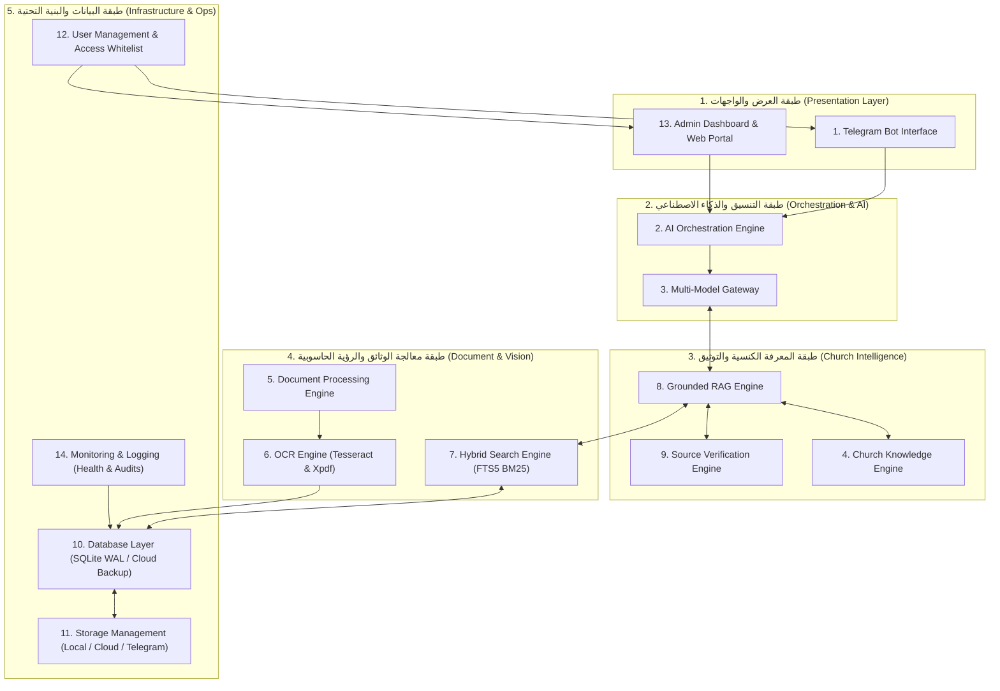

# ✠ ELANTONY LIBRARY AI - وثيقة البنية الموحدة الشاملة
## MASTER UNIFIED ARCHITECTURE SPECIFICATION (14 CORE SUBSYSTEMS)

**الإصدار:** 3.0.0 Enterprise Patristic Edition  
**المعمارية:** Clean Hexagonal Architecture with Modular RAG & Multi-Model Gateway  
**النطاق التشغيلي:** الكنيسة القبطية الأرثوذكسية والباحثون الأكاديميون والخدام  

---

### 1. نظرة معمارية عامة (Architecture Overview)

تعتمد منظومة **ELANTONY LIBRARY AI** على معمارية معيارية سداسية (Hexagonal Architecture) تفصل بين واجهات المستخدم، ومحركات الذكاء الاصطناعي، وطبقة المعرفة الكنسية، والتخزين الفعلي للكتب. تم تصميم النظام ليعمل بكفاءة فائقة على الخوادم المحلية والسحابية (Hybrid Multi-Cloud) مع دعم العمل دون اتصال بنسبة 100% عبر المحرك الحتمي وقاعدة البيانات المدمجة.

---

### 2. تفصيل الأنظمة الفرعية الأربعة عشر (The 14 Subsystems)

#### 1. واجهة بوت تليجرام (Telegram Bot Interface)
- **المسار:** `elantony/telegram/` (`bot_service.py`, `handlers.py`, `keyboards.py`).
- **المسؤوليات:** استقبال رسائل واستفسارات المستخدمين، دعم الأزرار التفاعلية، اختيار نمط العمق اللاهوتي (أكاديمي، رعوي، دفاعي)، إرسال ملفات الكتب بصيغة PDF مباشرة من السيرفر، وتوليد تلاوات صوتية لمقتطفات الآباء.
- **المرونة:** حلقة استطلاع طويلة (Long-Polling) غير قابلة للانهيار مع عزل الاستثناءات وتجديد السوكيت تلقائياً.

#### 2. محرك التنسيق الذكي (AI Orchestration Engine)
- **المسار:** `elantony/core/` و `elantony/web/api.py`.
- **المسؤوليات:** إدارة دورة حياة الجلسات الحوارية، تقييد المعدلات (Rate Limiting)، تصفية الاستعلامات من هجمات حقن التعليمات (Prompt Injection Defense)، وتجميع الشواهد في شجرة سياق منظمة.

#### 3. بوابة النماذج المتعددة (Elantony Multi-Model Gateway)
- **المسار:** `elantony/ai/gateway.py` و `openai_compatible_provider.py`.
- **المسؤوليات:** دعم مزودي الذكاء الاصطناعي (Gemini 2.5, Kimi K3, DeepInfer/Ollama, ZenMux, BeatAPI, Rule-Based)، التوجيه الذكي للنموذج المناسب بحسب صعوبة المسألة، ونظام التعاقب التلقائي (Cascading Fallback) عند انقطاع الاتصال أو نفاد الحصص.

#### 4. محرك المعرفة الكنسية (Church Knowledge Engine)
- **المسار:** `elantony/classifier/source_classifier.py` و `elantony/ai/rule_based_provider.py`.
- **المسؤوليات:** تصنيف المراجع حسب درجات الأصالة الكنسية:
  - **المرتبة الأولى (Tier 1):** نصوص الآباء الرسوليين والمجامع المسكونية وكتابات أثناسيوس وكيرلس وباسيليوس.
  - **المرتبة الثانية (Tier 2):** كتابات آباء الكنيسة الجامعة والتقليد الرهباني.
  - **المرتبة الثالثة (Tier 3):** مؤلفات وبحوث المعلمين الأقباط المعاصرين المعتمدين.

#### 5. محرك معالجة الوثائق (Document Processing Engine)
- **المسار:** `elantony/ocr/advanced_ocr.py` و `PyMuPDF` (`fitz`).
- **المسؤوليات:** قراءة وتجزئة ملفات الكتب (PDF, EPUB, DOCX)، استخراج النصوص، الحفاظ على ترقيم الصفحات المطبوعة مقابل صفحات الملف، وتقطيع النصوص إلى Chunks دلالية متداخلة بنسبة 15%.

#### 6. محرك المعالجة الضوئية (OCR Engine)
- **المسار:** ثنائيات `G:\Program Files\Tesseract-OCR` و `G:\Program Files\xpdf-tools`.
- **المسؤوليات:** استخراج النصوص من الكتب القديمة والممسوحة ضوئياً باستخدام محرك `Tesseract 5.x` والنموذج اللغوي العربي `ara` مع المعالجة الثنائية للألوان وإزالة التشويش (Deskew & Denoise).

#### 7. محرك البحث الهجين (Hybrid Search Engine)
- **المسار:** `elantony/search/search_engine.py`.
- **المسؤوليات:** بحث نصي ودلالي فائق السرعة عبر `SQLite FTS5` مع تطبيق خوارزمية `BM25 Ranking`، وتوحيد الحروف العربية (تجريد الهمزات والتشكيل والتاء المربوطة).

#### 8. محرك توليد الإجابات الموثقة (Grounded RAG Engine)
- **المسار:** `elantony/ai/` و `elantony/database/models.py`.
- **المسؤوليات:** حقن النصوص والشواهد الآبائية الحقيقية المسترجعة داخل سياق الاستعلام مع فرض قيود صارمة تمنع النموذج من الاعتماد على معلومات غير مؤكدة كنسياً.

#### 9. محرك التحقق من المصادر (Source Verification Engine)
- **المسار:** `elantony/ai/gemini_provider.py` و `gateway.py`.
- **المسؤوليات:** تصنيف كل فقرة إلى [اقتباس حرفي - QUOTATION]، [صياغة تحليلية - PARAPHRASE]، أو [استنتاج مركب - SYNTHESIS]، وضمان تطابق رقم الصفحة مع السجل الموثق في قاعدة البيانات.

#### 10. طبقة قواعد البيانات (Database Layer)
- **المسار:** `file_archive.db` و `elantony/database/repository.py`.
- **المسؤوليات:** تخزين بيانات أكثر من 7,200 كتاب، وملايين المقاطع النصية، وسجلات الجلسات الحوارية والأبحاث المحفوظة، مع تفعيل نمط الكتابة السريعة `WAL Mode` والنسخ الاحتياطي السحابي الدائم عبر Hugging Face Datasets.

#### 11. إدارة التخزين والملفات (Storage Management)
- **المسار:** `elantony/storage/` (`local_adapter.py`, `telegram_channel_adapter.py`, `onedrive_adapter.py`).
- **المسؤوليات:** إدارة وصول الملفات على القرص المحلي `I:\2021\2020\✠ Cross Coptic Library ✠` مع حماية الملفات الأصلية من أي تعديل أو حذف، ودعم التخزين السحابي وقنوات تليجرام المخصصة للتخزين.

#### 12. إدارة المستخدمين والصلاحيات (User Management)
- **المسار:** `elantony/core/security.py` و `config.py`.
- **المسؤوليات:** فحص الهوية والتحقق من القوائم المسموحة (`ALLOWED_TELEGRAM_USER_IDS`) وصلاحيات مديري النظام (`ADMIN_TELEGRAM_USER_IDS`) ومنع أي وصول غير مصرح به.

#### 13. لوحة التحكم الإدارية وبوابة الويب (Admin Dashboard & Web Portal)
- **المسار:** `elantony/web/api.py`.
- **المسؤوليات:** واجهة تفاعلية تتيح إدارة النظام، متابعة إحصائيات الفهرسة والـ OCR، تشغيل الصيانة، تنزيل الأبحاث بصيغة Word، وتصفح الكتب مباشرة في المتصفح.

#### 14. المراقبة وتسجيل الأحداث (Monitoring & Logging)
- **المسار:** `elantony/core/logging.py` ومسار `logs/`.
- **المسؤوليات:** تسجيل كافة العمليات والأخطاء بنظام التدوير اليومي، فحص صحة النظام عبر نقطة `/health`، ورصد أزمنة استجابة نماذج الذكاء الاصطناعي بدقة جزء من الثانية.
