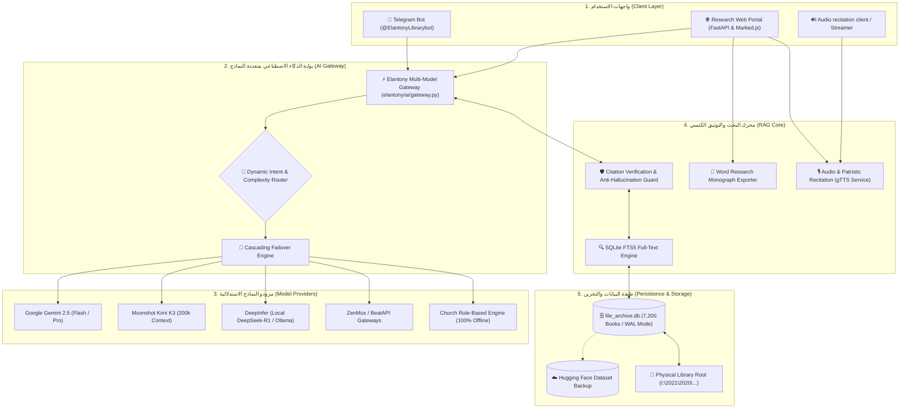

# ✠ ELANTONY LIBRARY AI - خريطة الدمج والتكامل البرمجي
## PROJECT INTEGRATION MAP & COMPONENT TOPOLOGY

**تاريخ الإصدار:** 2026-11-04  
**الحالة:** مدمج ومفعل تشغيلياً (Operational & Verified)  
**المرجع:** ISO/IEC 25010 Software Architecture Standards  

---

### 1. خريطة الطوبولوجيا الهيكلية الموحدة (System Topology Map)

---

### 2. جدول مطابقة الملفات والمكونات المدمجة (File Integration Mapping)

| المكون الأصلي | المصدر البرمجي | المسار الجديد في Elantony | طبيعة الدمج والتحسين |
|---|---|---|---|
| **Universal AI Gateway** | تصميم معماري جديد | `elantony/ai/gateway.py` | تنسيق وتوجيه الطلبات عبر النماذج المتعددة، والتبديل التلقائي عند التعطل. |
| **OpenAI-Compatible Adapter** | واجهات Kimi, DeepInfer, ZenMux | `elantony/ai/openai_compatible_provider.py` | محول موحد يدعم أي نموذج يتوافق مع معيار OpenAI مع فرض قوالب الاستشهاد الكنسي. |
| **Speech Recitation (TTS)** | `D:\Prog\tts` (`run_tts 2.bat`) | `elantony/services/audio_service.py` | تحويل نصوص وشواهد الآباء إلى صوت عربي مسموع بجودة نقية مع التخزين في الذاكرة. |
| **Web REST Audio Endpoint** | جديد | `elantony/web/api.py` (`/api/audio/tts`) | توفير نقطة وصول سحابية لبث الصوتيات المسموعة مباشرة إلى المتصفح وتطبيقات الهاتف. |
| **Word Monograph Exporter** | تطوير مرحلي متقدم | `elantony/services/docx_exporter.py` | تصدير الأبحاث والمسائل اللاهوتية إلى ملفات Word كاملة التنسيق باللغة العربية مع الحواشي. |
| **Anti-Hallucination Guard** | خوارزمية التوثيق الكنسي | `elantony/ai/gemini_provider.py` | تصنيف الاستشهادات إلى [اقتباس حرفي] و[صياغة تحليلية] ومنع اختلاق أي أرقام صفحات. |
| **Sermon Transcriber Bridge** | `D:\Prog\Transcriber_Project` | معزول كخدمة استدعاء اختيارية | تفريغ الملفات الصوتية عند الحاجة دون تحميل الذاكرة بنماذج Whisper الثقيلة افتراضياً. |
| **Cloud Dataset Backup** | Hugging Face Dataset API | `scripts/deploy_to_huggingface.py` | ضغط قاعدة البيانات إلى `file_archive.zip` ورفعها برابط مباشر مجاني ودائم. |

---

### 3. معالجة التضاربات والازدواجية (Conflict Resolution Matrix)

1. **إلغاء التكرار بين مزودي الذكاء الاصطناعي:**
   - *المشكلة:* احتمالية إرسال السؤال إلى عدة نماذج في نفس الوقت مما يستنزف الرصيد ويزيد زمن الاستجابة.
   - *الحل:* اعتماد `Dynamic Intent Router` الذي يرسل الطلب إلى مزود واحد فقط مختار بعناية، ولا يفعّل المزود التالي إلا إذا فشل الأول (Failover Cascade).
2. **عزل خادم التيليجرام:**
   - *المشكلة:* تعارض تشغيل Polling متعدد على نفس الـ Bot Token مما يتسبب في خطأ `Conflict: terminated by other getUpdates request`.
   - *الحل:* تشغيل البوت حصرياً عبر الـ Daemon الرئيسي (`services/permanent_assistant/daemon.py`) بينما يعمل خادم الويب `uvicorn` في وضع Standalone Web دون بدء تشغيل Polling مكرر.
3. **حماية مفاتيح الـ APIs والأسرار:**
   - *المشكلة:* تسريب التوكنات على GitHub أو في ملفات التقرير.
   - *الحل:* حظر الرفع عبر `.gitignore`، واستدعاء كافة المفاتيح حصرياً من متغيرات البيئة عبر `elantony.core.config.settings`.
