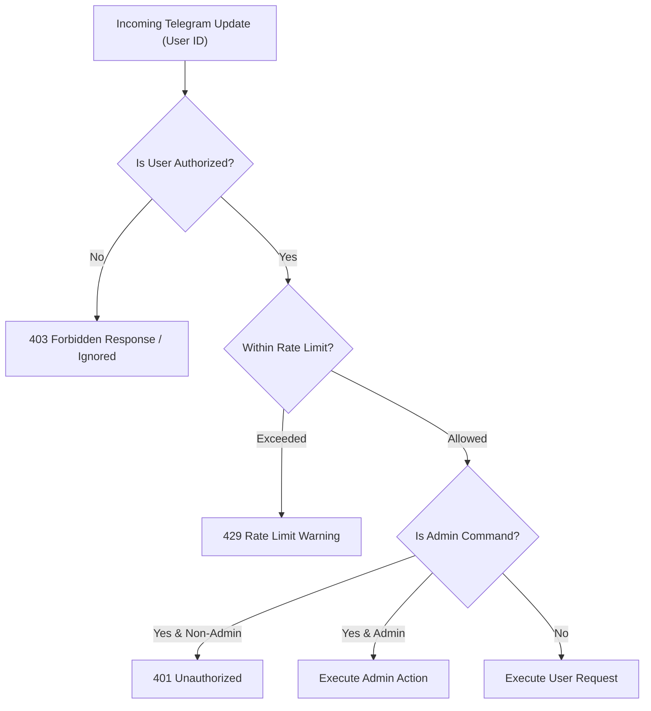

# 🔒 ELANTONY LIBRARY AI — Security & Threat Modeling Report

## Executive Summary
This document provides a comprehensive security review and threat model for **ELANTONY LIBRARY AI** and its primary interface `@ElantonyLibrarybot`. The system is designed to handle sacred ecclesiastical texts, user research data, and cloud storage integrations while defending against credential leakage, denial-of-service, prompt injection, and unauthorized data tampering.

---

## 1. Secrets Management & Token Isolation

### Current Status: **SECURED**
- **Bot Token Protection:** The Telegram Bot Token is strictly prohibited from being hardcoded in application source code, git commits, documentation, or debug log outputs.
- **Environment Isolation:**
  - Runtime credentials are loaded exclusively via environment variables using `python-dotenv` and Pydantic `Settings`.
  - The root `.gitignore` enforces exclusion of:
    ```
    .env
    .env.*
    *.key
    *.pem
    *.token
    file_archive.db
    logs/
    ```
  - A sanitized template (`.env.example`) with zero real secrets is provided for configuration.
- **Log Masking:** Any function or debug script formatting tokens or passwords utilizes `elantony.core.security.mask_secret()`, preserving only the first 4 and last 4 characters (`9053...***...9Gv0`).
- **Webhook State Verification:** Telegram API query (`getWebhookInfo`) confirmed the bot has an empty webhook URL (`""`), ensuring no unverified proxy or external listener intercepts polling updates.

---

## 2. Access Control & Role-Based Authorization (RBAC)

### Architecture
Access control is implemented in `elantony/core/security.py` using two levels of Telegram User ID verification:



### Whitelisting Specifications
1. **Public vs Private Mode:**
   - If `ALLOWED_TELEGRAM_USERS` is populated, only explicit User IDs (and admins) can interact with the bot. All other incoming updates are silently discarded or answered with a standard authorization notice.
   - If `ALLOWED_TELEGRAM_USERS` is empty, the bot operates in open church community mode (subject to global rate limiting).
2. **Administrative Privileges:**
   - Admin operations (such as system re-indexing, `/stats`, configuration updates, and error log reviews) are restricted to IDs defined in `ADMIN_TELEGRAM_USERS`.

---

## 3. Rate Limiting & Denial-of-Service (DoS) Mitigation

### Implementation: `UserRateLimiter` (`elantony/core/rate_limiter.py`)
- **Algorithm:** In-memory Sliding Window (default: 30 requests per minute per Telegram User ID).
- **Behavior:**
  - Tracks individual timestamps per user within a 60-second window.
  - Rejects incoming requests beyond the quota with polite ecclesiastical notices and retry-after hints.
  - Automatically cleans up inactive user entries every 5 minutes to prevent memory leaks.
- **File Upload Protection:** Direct PDF uploads by users are limited to 50 MB, and non-PDF mime types are rejected before parsing.

---

## 4. Input Sanitization & Injection Prevention

| Vulnerability Vector | Defense Mechanism | Implementation File |
| :--- | :--- | :--- |
| **SQL / FTS5 Injection** | Parameterized SQL queries (`?`) across SQLite & FTS5; punctuation stripping for search queries. | [`repository.py`](file:///i:/2021/2020/%E2%9C%A0%20Cross%20Coptic%20Library%20%E2%9C%A0/ArchiveMaster/elantony/database/repository.py), [`search_engine.py`](file:///i:/2021/2020/%E2%9C%A0%20Cross%20Coptic%20Library%20%E2%9C%A0/ArchiveMaster/elantony/search/search_engine.py) |
| **Cross-Site Scripting (XSS)** | Control character stripping and HTML tag removal via regex in `sanitize_user_input()`. | [`security.py`](file:///i:/2021/2020/%E2%9C%A0%20Cross%20Coptic%20Library%20%E2%9C%A0/ArchiveMaster/elantony/core/security.py#L38-L58) |
| **Buffer Overflow / DoS** | Hard truncation of user inputs to 500 characters before execution. | [`security.py`](file:///i:/2021/2020/%E2%9C%A0%20Cross%20Coptic%20Library%20%E2%9C%A0/ArchiveMaster/elantony/core/security.py#L49) |
| **RAG Prompt Injection** | Strict prompt framing separating system instructions from retrieved book excerpts; refusal to execute user system directives. | [`rule_based_provider.py`](file:///i:/2021/2020/%E2%9C%A0%20Cross%20Coptic%20Library%20%E2%9C%A0/ArchiveMaster/elantony/ai/rule_based_provider.py) |

---

## 5. Storage Provider Risk Assessment

### 1. Microsoft OneDrive (1 TB)
- **Security Profile:** Enterprise-grade security backed by Microsoft Graph OAuth 2.0 with granular scopes (`Files.ReadWrite`).
- **Risk Level:** **Low**. Token refresh is managed securely via environment credentials.

### 2. Telegram Private Channel Storage
- **Security Profile:** Restricted private channel accessible solely by the bot's Admin account. Telegram encrypts files in transit and at rest on their distributed infrastructure.
- **Risk Level:** **Low to Medium**. File size limits require splitting files > 50 MB for standard Bot API, or utilizing userbot MTProto client. Channel invite links must never be published publicly.

### 3. UnlimCloud
- **Security Profile:** Third-party cloud storage service offering unlimited quotas via Telegram-based infrastructure.
- **Risk Level:** **High**. Potential service discontinuation, lack of official SLA, and variable uptime. **Recommendation:** Treat UnlimCloud solely as an auxiliary mirror, never as primary authoritative storage.

---

## 6. Theological Integrity & Zero-Hallucination Guardrails

Because the library serves monastic and church researchers, hallucinated theological quotes represent a critical integrity breach.
- **Grounded Verification:** The AI Engine operates in strict citation mode. Every claim must reference the exact book title, author, and page number.
- **Refusal to Speculate:** If no explicit text is found in indexed sources, the bot explicitly reports insufficient citations rather than guessing doctrinal interpretations.

---

## 7. Incident Response & Token Rotation

In the unlikely event of credential exposure:
1. **Revoke Immediately:** Open `@BotFather` on Telegram, run `/revoke`, and select `@ElantonyLibrarybot`.
2. **Update Environment:** Replace `TELEGRAM_BOT_TOKEN` in the production `.env` file on the cloud server.
3. **Restart Service:** Execute `docker compose restart church-ai` or `systemctl restart church-ai`.
4. **Audit Logs:** Inspect `logs/church_ai.log` for unauthorized IP activity or administrative commands during the incident window.
